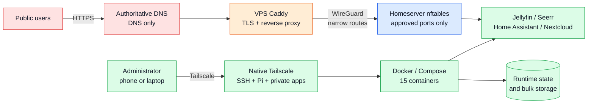

# Production-Style Personal Homeserver Infrastructure

A public-safe, declarative representation of my self-hosted infrastructure: an
on-premises Docker server, a small public VPS gateway, private remote administration,
and approval-gated AI-assisted operations.

This repository is the live infrastructure source of truth. Application data,
databases, credentials, private keys and machine-specific state stay outside Git.

> **Portfolio scope:** I did not author Jellyfin, Home Assistant, Nextcloud, Immich,
> or the other upstream applications. The engineering work here is architecture,
> integration, deployment, networking, security hardening, operations, recovery,
> troubleshooting and documentation.

## At a glance

| Area | Current deployment |
| --- | --- |
| Application host | Ubuntu 26.04 LTS, Intel i5-8300H, 14 GiB RAM |
| Acceleration | NVIDIA GTX 1050 passed into Jellyfin through Docker CDI |
| Storage | NVMe system disk + 1 TB bulk HDD |
| Containers | 15 running containers across 11 Compose projects |
| Public edge | Ubuntu ARM64 VPS running Caddy |
| Public applications | Jellyfin, Seerr, Home Assistant and Nextcloud |
| Private administration | Native Tailscale + OpenSSH |
| Edge-to-home transport | Direct WireGuard tunnel with narrow `/32` routes |
| Configuration model | Digest-pinned Compose and rendered host templates |
| AI operations | Pi Web UI on Tailscale with explicit tool approvals |

## Architecture



The VPS cannot browse the home LAN. The WireGuard peer can reach only the four
approved application ports; administration dashboards and SSH remain blocked over
that tunnel.

Detailed diagrams are maintained under [`docs/architecture`](docs/architecture/).

## Service inventory

### Media platform

| Service | Role | Access |
| --- | --- | --- |
| Jellyfin | Media library and hardware-accelerated playback | Public through VPS, LAN, Tailscale |
| Seerr | Media request workflow | Public through VPS, LAN, Tailscale |
| Sonarr | TV automation | LAN and Tailscale |
| Radarr | Movie automation | LAN and Tailscale |
| Prowlarr | Indexer integration | LAN and Tailscale |
| Bazarr | Subtitle automation | LAN and Tailscale |
| qBittorrent | Download client | Web UI on LAN/Tailscale; peer port separate |
| FlareSolverr | Prowlarr backend | Docker-internal only |

### Home and personal cloud

| Stack | Components | Access |
| --- | --- | --- |
| Home Assistant | Host-networked automation with Bluetooth integrations | Public through VPS, LAN, Tailscale |
| Nextcloud | Apache application + MariaDB | Public through VPS, LAN, Tailscale |
| Immich | Server + machine learning + PostgreSQL + Valkey | LAN and Tailscale |

The machine-readable inventory is [`inventory/services.yaml`](inventory/services.yaml).

## Media request flow

```text
Request in Seerr
  -> Sonarr or Radarr
  -> Prowlarr indexers
  -> qBittorrent download
  -> library import on bulk storage
  -> Jellyfin scan and playback
  -> Bazarr subtitle processing
```

All participating containers share an explicitly managed Docker network. Backend
APIs such as FlareSolverr and databases are not published to the host.

## Networking and trust boundaries

Four access classes are applied consistently:

1. **Public through VPS** — Caddy terminates TLS and proxies only approved services
   through WireGuard.
2. **LAN + Tailscale** — administrative application interfaces and host OpenSSH.
3. **Tailscale only** — Pi Web UI, protected by an additional application token.
4. **Container internal** — databases, Valkey, machine learning and FlareSolverr.

Docker-published ports require special handling because ordinary host firewall
rules can be bypassed after destination NAT. The homeserver therefore installs an
nftables prerouting guard before Docker DNAT. A second independent nftables table
limits traffic arriving from the VPS WireGuard peer.

Wi-Fi is disabled. Ethernet uses a router-reserved DHCP address, and
`systemd-networkd-wait-online` waits only for that interface.

## Security controls

- Immutable SHA-256 image digests for all 15 container images
- No automatic image pulls during deployment
- Secrets and runtime state excluded from Git
- Independently rotated, high-entropy database credentials
- Root-only WireGuard and Tailscale state
- Native Tailscale service independent of Docker for recovery access
- VPS key-only SSH, direct root login disabled, Fail2ban enabled
- Caddy admin API restricted to loopback
- Narrow WireGuard routes and explicit application allow-list
- Global IPv6 access blocked for protected homeserver service ports
- Pre-change backups and post-change health/boundary verification

See [`docs/security`](docs/security/) for the security model and limitations.

## Declarative source of truth

Tracked files define:

- Docker Compose stacks and immutable images
- Host firewall templates
- Netplan Ethernet configuration template
- WireGuard guard/watchdog units
- Native Tailscale systemd drop-in
- VPS Caddy, SSH and Fail2ban configuration
- Service inventory and operating procedures

Private files under `~/.config/homeserver/` provide host paths, topology and stack
credentials. The runtime tree contains only application state and bind-mounted data;
it deliberately has no independent Compose definitions.

```text
Repository change
  -> syntax and secret validation
  -> drift check
  -> one-stack deployment
  -> health/integration/access verification
  -> documentation update
```

## Operations

```bash
# Redacted host, network, service and container snapshot
./scripts/status.sh

# Compare image IDs, full Compose hashes and repository ownership
./scripts/check-drift.sh

# Validate one stack without applying it
./scripts/deploy-stack.sh sonarr --check

# Apply one already-reviewed stack using local immutable images
./scripts/deploy-stack.sh sonarr
```

Deployment is protected by an ignored, host-local safety marker. A fresh clone
cannot deploy until an operator provides private environment files, validates the
host and intentionally enables it.

Operational details are in [`docs/operations/RUNBOOK.md`](docs/operations/RUNBOOK.md).
New services follow [`docs/operations/ADDING-A-SERVICE.md`](docs/operations/ADDING-A-SERVICE.md).

## AI-assisted administration

A maintained Pi Web UI is bound only to the Tailscale address. Pi uses this
repository as its workspace and automatically loads [`AGENTS.md`](AGENTS.md), the
service inventory and runbooks in new sessions.

The workflow asks for approval before shell commands, writes and sensitive reads.
It also requires diagnosis, scoped changes, backups for high-impact work, and
verification. These approvals are operational controls—not an OS sandbox. The Pi
process still has the host user's permissions, and Docker access is root-equivalent.

## Reliability and recovery

- Containers use `restart: unless-stopped` and were verified after controlled reboots.
- Native Tailscale and OpenSSH start without a local graphical login.
- A WireGuard watchdog checks reachability and recovers stale one-sided sessions
  with age and cooldown safeguards.
- Previous image digests are retained during controlled application upgrades.
- Configuration/database backups are created before high-impact migrations.
- SMART self-tests and post-boot storage checks are part of host maintenance.

This remains a single-node personal lab: the bulk disk has no RAID redundancy, and
Git is not a backup for application data or media.

## Engineering case studies

The project includes investigations where the result mattered more than simply
restarting a container:

- [Home Assistant stale Docker DNS](docs/incidents/01-home-assistant-docker-dns.md)
- [qBittorrent tracker and DHT recovery](docs/incidents/02-qbittorrent-dns-dht-recovery.md)
- [Caddy over WireGuard VPS migration](docs/incidents/03-caddy-wireguard-vps-migration.md)
- [One-sided WireGuard reboot recovery](docs/incidents/04-wireguard-reboot-recovery.md)
- [Native Tailscale migration](docs/incidents/05-native-tailscale-migration.md)
- [Docker pre-DNAT service firewall](docs/incidents/06-docker-prednat-firewall.md)
- [Live deployment to source-of-truth cutover](docs/incidents/07-source-of-truth-cutover.md)

Structured incident reports live in [`docs/incidents`](docs/incidents/).

## Repository layout

```text
compose/                 Production-capable public-safe Compose definitions
infrastructure/          Caddy, firewall, network, SSH, systemd and VPN templates
inventory/               Machine-readable host and service inventory
scripts/                 Status, validation, drift and deployment tooling
docs/architecture/       Diagrams and request/data flows
docs/operations/         Runbooks and maintenance procedures
docs/security/           Trust boundaries and secret handling
docs/incidents/          Root-cause case studies
.github/workflows/       Non-deploying validation (added before publication)
```

## Reproducing the pattern

This repository is a reference architecture, not a universal one-command installer.
A new deployment must provide:

1. A private runtime environment based on `runtime.env.example`
2. Per-stack secret files based on committed `.env.example` templates
3. Existing storage directories and ownership appropriate to the chosen UID/GID
4. A Docker network for the media applications
5. WireGuard keys and peer endpoints generated outside Git
6. DNS records and Caddy environment appropriate to the operator's domain
7. Reviewed firewall values for the actual LAN/interface topology
8. An explicit local deployment-enable marker after validation

Never reuse example passwords, keys, addresses or domains.

## Live deployment and screenshots

The infrastructure is actively deployed. Public applications require authentication;
no recruiter/demo credentials are issued against the production server. Architecture
diagrams document the system without exposing live accounts or personal media;
sanitized screenshots can be added later if useful.

## License

Infrastructure templates, scripts and documentation are available under the
[MIT License](LICENSE). Upstream applications retain their own licenses.
