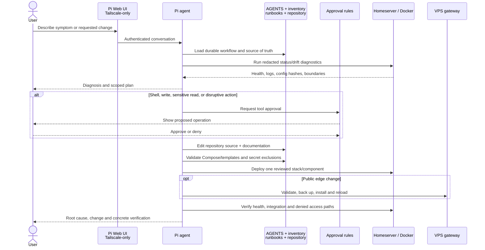
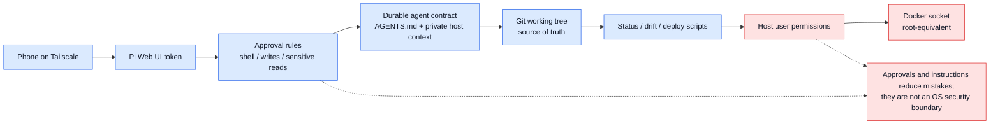

# AI-assisted operations and approval flow

## Control layers

## Durable context for new sessions

New Pi sessions do not depend on conversation memory. They receive:

- Host-level private context from the Pi agent directory
- Repository `AGENTS.md`
- Machine-readable service inventory
- Operations/security runbooks
- Live redacted state from `scripts/status.sh`
- Exact Compose image/config/ownership drift from `scripts/check-drift.sh`

The model still cannot infer undocumented application UI changes. Architecture-
significant settings must be recorded without exporting secret-bearing runtime data.
