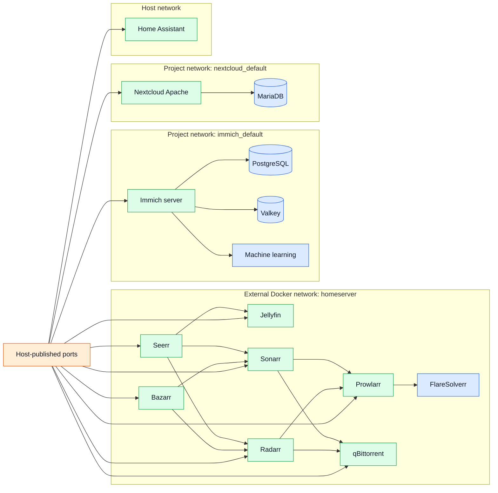

# Container network topology

## Isolation choices

- Media services use one explicit external network because they intentionally call
  each other's APIs by container name.
- Immich and Nextcloud keep databases on project-local networks.
- FlareSolverr is reachable by Prowlarr but has no host-published port.
- Home Assistant uses host networking for LAN discovery and Bluetooth integrations;
  host firewall rules protect its HTTP listener.
- Container-network membership is convenience/connectivity, not a strong sandbox
  against a compromised container.
