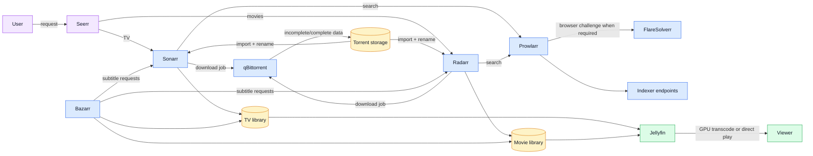

# Media request and processing pipeline

## Operational properties

- `/data` mappings are consistent across Sonarr, Radarr and Bazarr so imported
  paths refer to the same underlying storage.
- qBittorrent peer traffic is separate from its private Web UI.
- FlareSolverr is a backend API, not an administrator-facing service.
- Jellyfin reads final libraries and can use NVIDIA hardware acceleration.
- Request automation cannot replace storage monitoring, import verification or
  application-level authentication.
