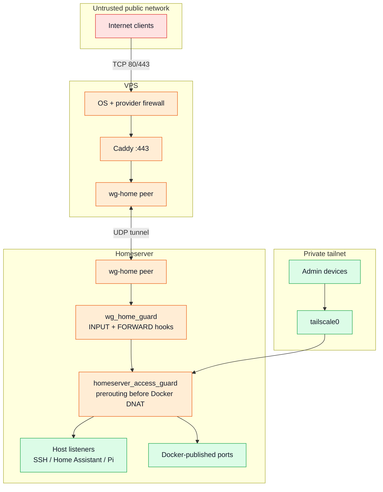

# Networking and trust boundaries

## Request paths

## Access matrix

| Source | Permitted destinations | Explicitly excluded |
| --- | --- | --- |
| Public internet | VPS Caddy on HTTP/HTTPS | Direct homeserver ports |
| VPS WireGuard peer | TCP 5055, 8088, 8096, 8123 | SSH and private dashboards |
| Home LAN | Application ports and SSH | FlareSolverr/database direct access |
| Tailscale | Private apps, SSH, public apps | Pi still requires its application token |
| Docker networks | Required service-to-service APIs | No implied public exposure |

## Why the guard runs before Docker DNAT

Docker installs forwarding/NAT rules for published ports. An INPUT-only policy can
therefore produce a false sense of protection. `homeserver_access_guard` attaches
a prerouting filter before Docker destination NAT, matches original host service
ports, and permits only classified interfaces/sources.

The separate `wg_home_guard` table applies both INPUT and FORWARD hooks so the VPS
peer cannot use the tunnel to reach the LAN or unrelated containers.

## Addressing policy

The public repository uses placeholders. Live values are supplied from root/user
private environment files:

- Ethernet interface and router-reserved DHCP address
- LAN CIDR
- WireGuard peer `/32` addresses
- VPS public endpoint and DNS hostnames

Wi-Fi is disabled and is not accepted as a trusted LAN ingress interface.
