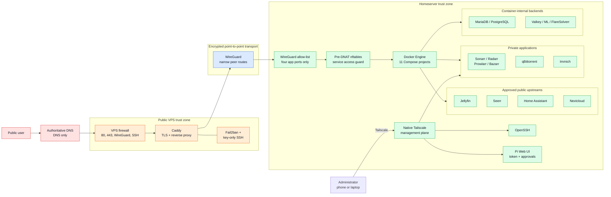

# System overview

This diagram separates public delivery, private administration and runtime state.
Only four applications cross the VPS-to-home boundary.

## Design properties

- Public TLS ends on the VPS; the upstream HTTP hop is protected by WireGuard.
- WireGuard routes only peer addresses, not the home LAN or default route.
- The homeserver peer firewall permits only Jellyfin, Seerr, Home Assistant and
  Nextcloud from the VPS.
- Native Tailscale remains available even when Docker is broken.
- Databases and support backends have no host-published management port.
