# Storage and data placement

```mermaid
flowchart TB
    subgraph nvme[NVMe system storage]
        os[Ubuntu + systemd]
        repo[Infrastructure Git repository]
        runtime[Application runtime root]
        appcfg[App config / SQLite state]
        dbs[MariaDB + PostgreSQL data]
        private[Private host/stack env files]
        os --> repo
        runtime --> appcfg
        runtime --> dbs
    end

    subgraph hdd[Bulk HDD]
        torrents[Torrent data]
        movies[Movie library]
        tv[TV library]
        nextcloud[Nextcloud user data]
        immich[Immich library]
    end

    subgraph containers[Ephemeral container layers]
        images[Digest-pinned images]
        processes[Running containers]
        images --> processes
    end

    repo -->|Compose + templates| processes
    private -->|environment at deploy time| processes
    appcfg <-->|bind mounts| processes
    dbs <-->|bind mounts| processes
    torrents <-->|bind mounts| processes
    movies <-->|read/import| processes
    tv <-->|read/import| processes
    nextcloud <-->|bind mount| processes
    immich <-->|bind mount| processes

    backup[Private temporary rollback backups]
    appcfg -. selected config backup .-> backup
    dbs -. logical dumps before migration .-> backup

    risk[Single-node storage<br/>no RAID redundancy]
    hdd --- risk

    classDef system fill:#dbeafe,stroke:#2563eb,color:#111827
    classDef data fill:#fef3c7,stroke:#d97706,color:#111827
    classDef runtimeClass fill:#dcfce7,stroke:#16a34a,color:#111827
    classDef riskClass fill:#fee2e2,stroke:#dc2626,color:#111827
    class os,repo,runtime,private system
    class appcfg,dbs,torrents,movies,tv,nextcloud,immich,backup data
    class images,processes runtimeClass
    class risk riskClass
```

## Persistence boundary

| Category | Git | Runtime backup | Replaceable |
| --- | --- | --- | --- |
| Compose, templates, docs, scripts | Yes | Git history after publication | Reproducible |
| Private env and keys | Never | Private encrypted/offline strategy | Rotatable, disruptive |
| Application config/databases | Never | Service-aware backup | Usually important |
| Media/torrents | Never | User-selected | Mostly replaceable here |
| Container image layers | No | Digest references only | Pullable by digest |

The temporary publication rollback archive is intentionally not a permanent backup
solution and is scheduled for deletion after final acceptance.
